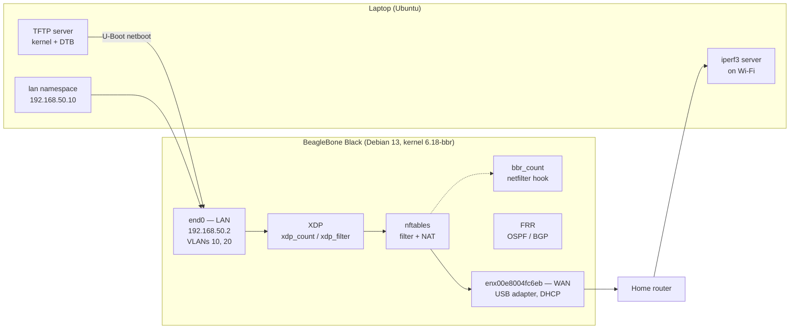

# bbb-router

A BeagleBone Black turned into an edge router with own U-Boot and kernel, nftables firewall/NAT, VLANs, OSPF/BGP, a netfilter module, XDP, tools,tests and CI

## Architecture

## Hardware
Board, serial adapter, USB Ethernet adapter, cables.

## Goals

- Understand the embedded Linux boot chain on real hardware by building my U-Boot and kernel and booting them over the network (TFTP).
- Build a working edge router: forwarding, NAT, an nftables firewall, and separated office and guest VLANs.
- Learn dynamic routing with FRR (OSPF and BGP) and how Linux exposes networking to user space through netlink.
- Write and compare packet-processing code at three levels: nftables rules, a netfilter kernel module, and eBPF/XDP programs, with measured costs.
- Find real performance bottlenecks with perf, mpstat and sar instead of guessing.
- Practise a professional workflow: git branches and pull requests, namespace and hardware-in-the-loop tests, CI, Debian packaging, DKMS, documentation, and the kernel patch process.

## Known limitations
- The SR9700 USB adapter links at 10 Mbit/s half-duplex. TCP upload reaches about 5 Mbit/s, and downloads stall, most likely because of a duplex mismatch.
- The arm32 BPF JIT rejects the XDP program, so it runs in the interpreter.
- Booting needs the laptop, because U-Boot loads the kernel over TFTP.
- The single CPU saturates at about 28,000 forwarded packets per second, and the board stops responding.
- In the namespace tests, the VLANs are veths named like the board’s interfaces, so VLAN tagging itself isn’t tested.
- The hardware tests need an SSH key and the sudoers rule on the board.
